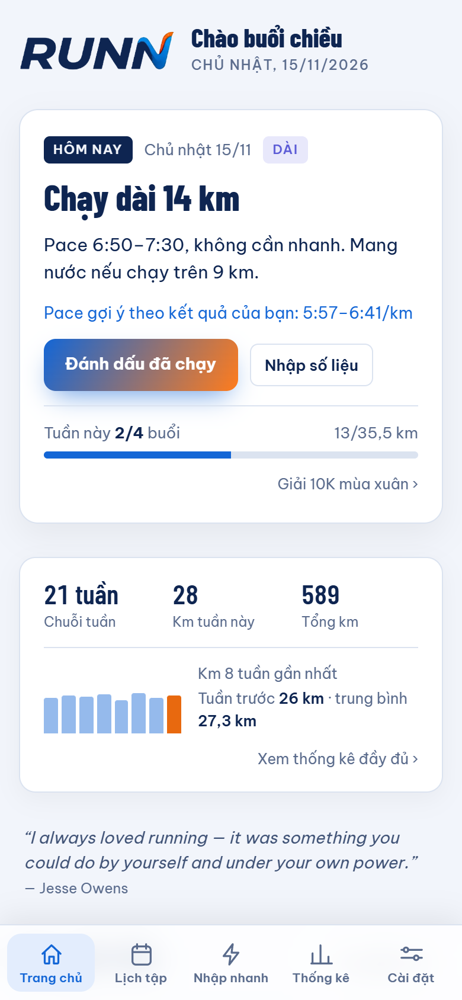
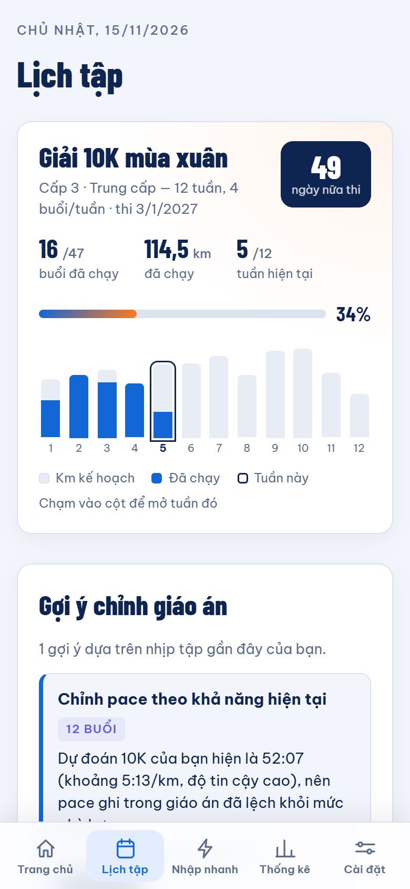
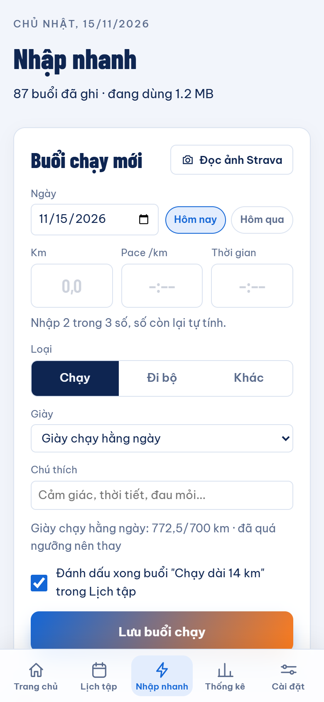
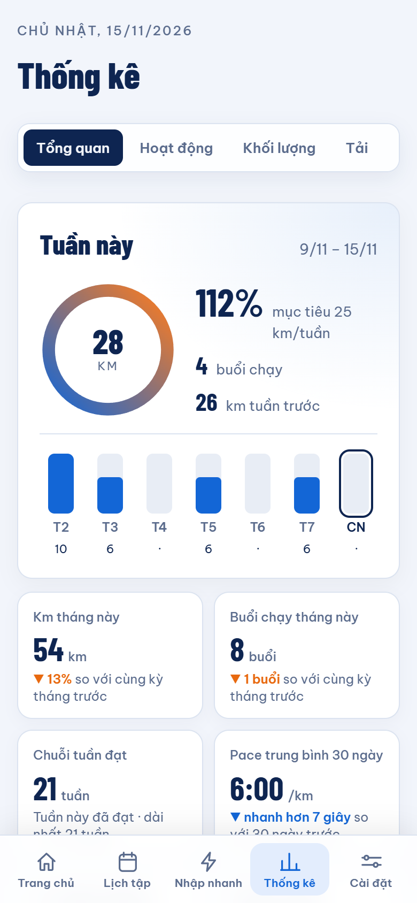
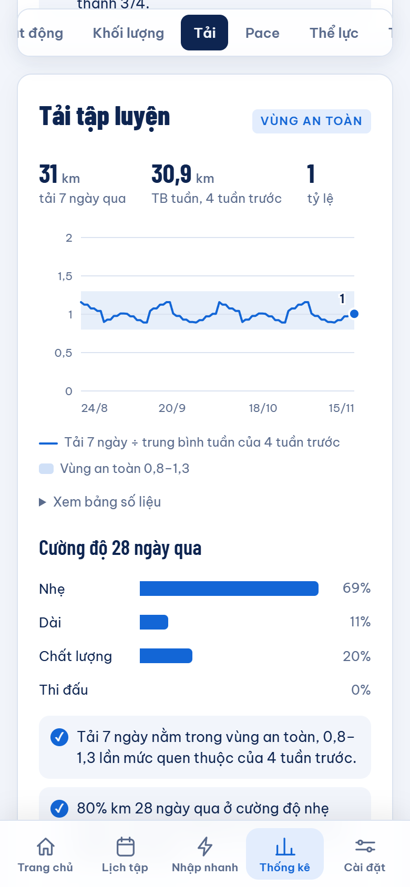
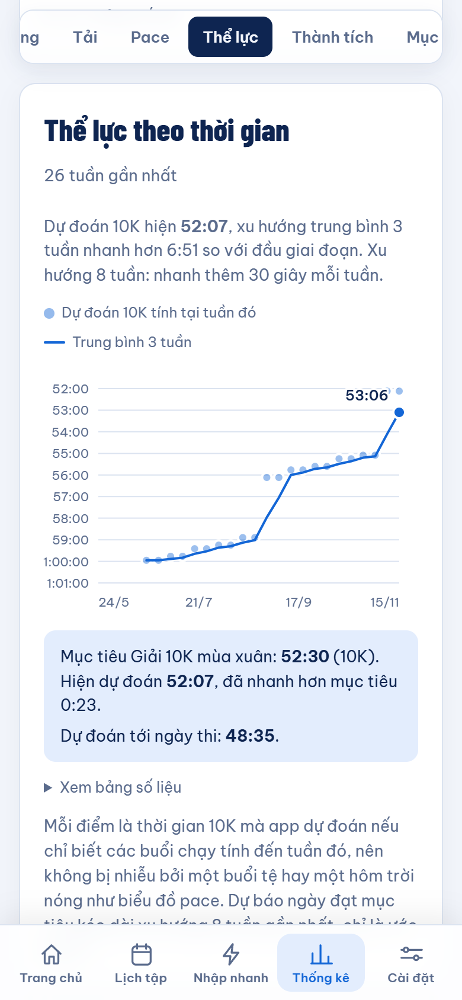
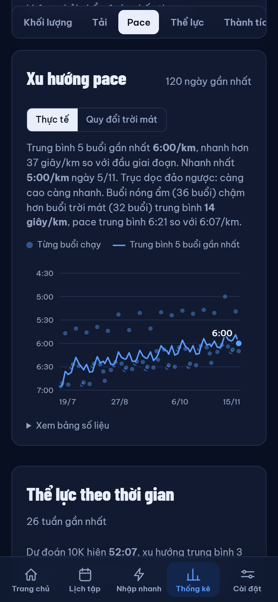
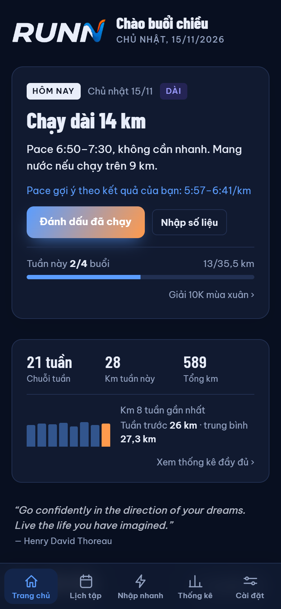

<div align="center">

<picture>
  <source media="(prefers-color-scheme: dark)" srcset="icons/logo-dark.png">
  
</picture>

### Nhật ký chạy cho mọi người chạy bộ

Ghi buổi chạy trong vài giây, theo một giáo án hợp sức mình, và biết rõ mình đang tiến bộ tới đâu.<br>
Không cần tài khoản: dữ liệu nằm trong máy của bạn.

[**Mở app → www.runn.io.vn**](https://www.runn.io.vn)


</div>

<table>
  <tr>
    <td align="center"><br><sub><b>Trang chủ</b> · việc hôm nay</sub></td>
    <td align="center"><br><sub><b>Lịch tập</b> · giáo án 12 tuần</sub></td>
    <td align="center"><br><sub><b>Nhập nhanh</b> · gõ 2 số là xong</sub></td>
    <td align="center"><br><sub><b>Thống kê</b> · tuần này</sub></td>
  </tr>
  <tr>
    <td align="center"><br><sub><b>Tải tập luyện</b> · tránh tăng quá nhanh</sub></td>
    <td align="center"><br><sub><b>Thể lực</b> · khi nào đạt mục tiêu</sub></td>
    <td align="center"><br><sub><b>Pace</b> · quy đổi trời mát</sub></td>
    <td align="center"><br><sub><b>Giao diện tối</b></sub></td>
  </tr>
</table>

---

## Mục lục

- [Điểm nổi bật](#điểm-nổi-bật)
- [Bắt đầu sử dụng](#bắt-đầu-sử-dụng)
- [Tính năng](#tính-năng)
  - [Trang chủ](#trang-chủ) · [Lịch tập](#lịch-tập) · [Nhập nhanh](#nhập-nhanh) · [Thống kê](#thống-kê) · [Trang của một giải](#trang-của-một-giải) · [Cài đặt](#cài-đặt) · [Nhắc chạy](#nhắc-chạy)
- [Cách app tính toán](#cách-app-tính-toán)
- [Quyền riêng tư và dữ liệu](#quyền-riêng-tư-và-dữ-liệu)
- [Ứng dụng cài được và dùng offline](#ứng-dụng-cài-được-và-dùng-offline)
- [Dành cho nhà phát triển](#dành-cho-nhà-phát-triển)
- [Gặp trục trặc](#gặp-trục-trặc)

---

## Điểm nổi bật

- **Biết hôm nay chạy gì, ghi lại trong một chạm.** Trang chủ cho thấy buổi tập hôm nay, pace nên chạy và tiến độ tuần. Chạy xong bấm **Đánh dấu đã chạy** là xong.
- **Giáo án hợp sức mình.** Chọn 1 trong 5 cấp độ (từ người mới tới chạy cạnh tranh), hoặc nhập mục tiêu thời gian để app **sinh giáo án riêng** theo nhật ký 4 tuần gần nhất.
- **Giáo án tự điều chỉnh.** Nghỉ ốm, tuần bận, hay tiến bộ nhanh hơn dự kiến, app đề xuất giảm khối lượng hoặc chỉnh pace, kèm lý do rõ ràng.
- **Ghi buổi chạy nhanh.** Chỉ cần 2 trong 3 số km / pace / thời gian. Hoặc chụp màn hình Strava, AI đọc giúp, nhập được cả loạt ảnh một lúc.
- **Biết mình có đang tiến bộ không.** Đường thể lực theo tuần, dự đoán 5K / 10K / Half / Full, và ước ngày đạt mục tiêu của giải sắp tới.
- **Tập an toàn hơn.** Tải tập luyện so tuần này với 4 tuần trước để cảnh báo khi tăng quá nhanh, kèm tỷ lệ chạy nhẹ theo nguyên tắc 80/20.
- **Công bằng với thời tiết.** Tự gắn nhiệt độ, độ ẩm vào từng buổi và quy đổi pace về điều kiện trời mát, để mùa hè không che mất tiến bộ thật.
- **Riêng tư.** Không tài khoản, không máy chủ lưu nhật ký. Ảnh không bao giờ rời khỏi máy, trừ lúc bạn chủ động nhờ AI đọc.

---

## Bắt đầu sử dụng

**1. Mở và cài app.** Vào [www.runn.io.vn](https://www.runn.io.vn), rồi thêm ra màn hình chính để dùng như app thật:

| Thiết bị | Cách cài |
| --- | --- |
| Android (Chrome) | Menu ⋮ → **Cài đặt ứng dụng** (hoặc **Thêm vào màn hình chính**) |
| iPhone / iPad (Safari) | Nút **Chia sẻ** → **Thêm vào MH chính** |
| Máy tính (Chrome, Edge) | Biểu tượng cài đặt ở cuối thanh địa chỉ |

**2. Tạo giải bạn muốn chạy.** Trang chủ → **+ Tạo giải mới** → nhập tên, ngày thi, cự ly, rồi chọn giáo án (xem bảng dưới). Không theo giáo án cũng được: chọn "Không dùng giáo án" và cứ ghi nhật ký tự do.

**3. Ghi buổi chạy.** Bấm **Đánh dấu đã chạy** ở trang chủ, hoặc mở **Nhập nhanh** để ghi số liệu, ảnh, giày, chú thích.

**4. Tuỳ chọn thêm** ở **Cài đặt**: dán Gemini API key miễn phí để đọc ảnh Strava và hỏi AI, chọn thành phố để tự gắn thời tiết, bật nhắc chạy buổi sáng, và thỉnh thoảng **xuất file sao lưu**.

### Chọn giáo án

| Giáo án | Thời gian | Buổi/tuần | Km/tuần lúc cao nhất | Dành cho |
| --- | --- | --- | --- | --- |
| **Cấp 1 · Khởi đầu** | 8 tuần | 3 | 16 | Mới chạy hoặc chạy lại sau thời gian dài nghỉ, chưa chạy liền được 30 phút |
| **Cấp 2 · Cơ bản** | 10 tuần | 4 | 31 | Đã chạy đều vài tháng, chạy liền 5 km thoải mái |
| **Cấp 3 · Trung cấp** | 12 tuần | 4 | 43 | Chạy 30–45 km/tuần, đã hoàn thành ít nhất một giải |
| **Cấp 4 · Nâng cao** | 14 tuần | 5 | 73 | Chạy 50–70 km/tuần, chịu được hai buổi chất lượng mỗi tuần |
| **Cấp 5 · Cạnh tranh** | 16 tuần | 6 | 101 | Trên 70 km/tuần, nhắm thứ hạng nhóm tuổi |
| **Chu kỳ 12 tuần 10K (cổ điển)** | 12 tuần | 4 (hoặc 3) | 29 | Giáo án 10K kinh điển, đổi được giữa 4 và 3 buổi/tuần |
| **Giáo án riêng theo mục tiêu** | 6–20 tuần | 3–6 | theo bạn | Nhập mục tiêu, ví dụ 10K trong 52:30, app tự sinh |

Mọi giáo án đều chia giai đoạn: nền tảng → xây sức bền → đặc thù cự ly → giảm tải → tuần thi đấu.

---

## Tính năng

### Trang chủ

| | |
| --- | --- |
| **Buổi tiếp theo** | Gộp từ mọi giải đang có giáo án. Hiện tên buổi, mô tả, pace gợi ý theo kết quả của bạn và tiến độ tuần này, ví dụ "2/4 buổi · 13/35,5 km". |
| **Đánh dấu đã chạy** | Một chạm ngay trên trang chủ, có pháo hoa. Thẻ ghi "✓ Đã xong hôm nay" rồi chuyển sang buổi kế tiếp. |
| **Nhập số liệu** | Mở Nhập nhanh đúng ngày của buổi; lưu xong là buổi tự được đánh dấu. |
| **Tóm tắt nhanh** | Chuỗi tuần, km tuần này, tổng km, cột km 8 tuần gần nhất. Bấm vào để mở Thống kê. |
| **Câu truyền động lực** | 200 câu, chạm để đổi câu. |
| **Các giải đấu** | Thẻ có đếm ngược, giáo án và thanh tiến độ; bấm vào để mở trang giải. Tạo giải mới ngay tại đây. |

### Lịch tập

- **Thẻ tổng quan**: số ngày tới giải, số buổi và km đã chạy, biểu đồ km từng tuần (kế hoạch và đã chạy). Chạm vào một cột để mở tuần đó.
- **Gợi ý chỉnh giáo án**: đề xuất giảm khối lượng hay chỉnh pace, kèm lý do và danh sách buổi sẽ đổi. Bấm **Áp dụng**, hoặc bật **Tự động áp dụng gợi ý mỗi khi mở app**. Xem [cách tính](#tự-điều-chỉnh-giáo-án).
- **Lịch tháng** chấm màu theo loại buổi: nhẹ, chất lượng, dài, thi đấu, đã chạy, bỏ lỡ. Chạm một ngày để xem buổi tập và nhật ký của ngày đó.
- **Lịch tuần** cho cả giáo án, mỗi buổi có ô tích, ghi chú, pace gợi ý.
- **Sửa buổi**: đổi loại, tên, km, mô tả; có nút **Về bản gốc**. **Xoá buổi**: chuyển vào mục "Buổi đã xoá", khôi phục được bất cứ lúc nào. Khuôn giáo án gốc không bao giờ bị đụng tới.
- **Đổi ngày chạy** cho cả giáo án hoặc riêng từng tuần bận.

### Nhập nhanh

- **Form gọn trong một màn hình**: ngày (có nút Hôm nay / Hôm qua) → km, pace, thời gian → loại (chạy / đi bộ / khác) → giày → chú thích. Nhập **2 trong 3 số**, số còn lại tự tính.
- **Tự đánh dấu buổi trong giáo án**: nếu ngày đó có buổi chưa xong, ô "Đánh dấu xong buổi…" được tích sẵn.
- **Đọc ảnh Strava bằng AI**: chọn, kéo thả hoặc dán (Ctrl+V) ảnh chụp màn hình, Gemini đọc km, pace, thời gian, ngày và phân biệt chạy với đi bộ. Đi bộ không tính vào chuỗi, PR, dự đoán.
- **Nhập hàng loạt**: chọn nhiều ảnh cùng lúc, mỗi ảnh một dòng để soát, đọc song song 3 ảnh một lúc. Dòng có vẻ trùng một buổi đã lưu (cùng ngày, cùng km) tự bỏ tích.
- **Chia sẻ thẳng từ Strava** (Android, app đã cài): trong Strava bấm Chia sẻ ảnh → chọn "Nhật ký chạy", app mở sẵn ảnh và đọc luôn.
- **Thời tiết tự gắn**: mỗi buổi chạy, đi bộ được gắn nhiệt độ, độ ẩm và hiện "≈ 6:05/km khi trời mát".
- **Mất mạng vẫn lưu được**: việc đọc ảnh và lấy thời tiết được xếp hàng, có mạng lại thì app tự làm nốt.
- **Giày**: chọn giày cho từng buổi; app báo khi đôi giày chạm 80% và 100% ngưỡng nên thay.
- **Nhật ký có tìm kiếm và bộ lọc**: tìm theo chú thích, giày, ngày, không cần gõ dấu ("dau goi" tìm ra "đau gối"); lọc theo loại, khoảng ngày, km, giày, có ảnh; sắp xếp mới nhất, cũ nhất, dài nhất, pace nhanh nhất. Mỗi buổi có **Sửa** và **Xoá**.

### Thống kê

| Mục | Nội dung |
| --- | --- |
| **Tuần này** | Vòng tiến độ theo mục tiêu km/tuần (hoặc trung bình 8 tuần), km từng ngày |
| **Ô số liệu** | Km và số buổi tháng này so với cùng kỳ tháng trước, chuỗi tuần đạt, pace trung bình 30 ngày, tổng quãng đường, tổng thời gian |
| **Lịch hoạt động** | Lịch nhiệt từng ngày; chuỗi ngày hiện tại và dài nhất |
| **Khối lượng** | Km theo tuần hoặc tháng trong 12 kỳ, đường trung bình, nhận xét xu hướng (tăng quá 10%, tỷ lệ hoàn thành buổi chất lượng và buổi dài) |
| **Tải tập luyện** | Tỷ lệ tải 7 ngày / 4 tuần trước, vùng an toàn 0,8–1,3, cơ cấu cường độ 28 ngày |
| **Xu hướng pace** | Từng buổi và trung bình 5 buổi trong 120 ngày; chuyển giữa pace thực tế và **quy đổi trời mát**; so buổi nóng ẩm với buổi trời mát |
| **Thể lực theo thời gian** | Dự đoán 10K của từng tuần trong 26 tuần, xu hướng 8 tuần, ước **ngày đạt mục tiêu** của giải sắp tới |
| **Phân bố cự ly** | Số buổi theo nhóm cự ly, buổi dài nhất |
| **Thành tích tốt nhất** | PR 5K, 10K, Half, Full tự nhận ra từ nhật ký |
| **Dự đoán thành tích** | Thời gian, pace, khoảng sai số, độ tin cậy cho 4 cự ly; vùng pace gợi ý (nhẹ, tempo, interval, pace Full) |
| **Mục tiêu** | Km/tuần, số buổi/tuần, km/tháng, mục tiêu thành tích, có thanh tiến độ |
| **Giày chạy** | Km từng đôi, mức mòn, ước số tuần còn dùng, gán hàng loạt buổi chưa có giày, cho đôi cũ nghỉ |
| **Báo cáo AI** | Báo cáo 5 mục: tổng quan, điểm mạnh, cần lưu ý, dự đoán và chiến lược, gợi ý tuần tới |
| **Hỏi AI** | Hỏi tự do, ví dụ "Tuần này chạy dài bao nhiêu?" hay "Nghỉ ốm thì quay lại thế nào?". AI chỉ dùng số liệu app đã tính. |

### Trang của một giải

Đếm ngược tới ngày thi, thanh tiến độ, buổi tiếp theo, biểu đồ km theo tuần, chọn thứ chạy mặc định cho từng loại buổi, và tab **Tham khảo** (các mức pace, mục tiêu A/B/C, nguyên tắc tập). Cuối trang là mục **Quản lý giải**: sửa tên, ngày, cự ly, đổi giáo án (kể cả sinh lại giáo án riêng), hoặc xoá giải. Xoá giải không xoá nhật ký chạy.

### Cài đặt

- **Giao diện**: sáng, tối, hoặc theo máy.
- **Đọc ảnh Strava tự động**: Gemini API key (lấy miễn phí ở [Google AI Studio](https://aistudio.google.com/apikey)), tên model, nút thử kết nối.
- **Thời tiết lúc chạy**: tìm thành phố hoặc dùng vị trí hiện tại, chọn giờ bạn hay chạy, lấy thời tiết cho các buổi cũ, và tuỳ chọn kèm thời tiết vào thông báo sáng.
- **Nhắc chạy trên điện thoại**: bật/tắt, giờ nhắc khi app mở, gửi thử, kiểm tra máy chủ.
- **Dung lượng**: ảnh chiếm bao nhiêu, còn chỗ cho khoảng bao nhiêu ảnh, dữ liệu đã được lưu bền chưa.
- **Sao lưu và khôi phục**: một file JSON chứa toàn bộ giải, giáo án, nhật ký kèm ảnh, giày, mục tiêu. Khôi phục là **gộp** vào dữ liệu hiện có, không xoá gì.

### Nhắc chạy

Thông báo đẩy lúc **6:30 sáng** (giờ Việt Nam) kể cả khi đã đóng app, áp dụng cho mọi giải đang có giáo án:

| Hôm nay | Thông báo |
| --- | --- |
| Có buổi chạy chưa đánh dấu | "Hôm nay có buổi chạy" kèm tên buổi. Nếu bật **Kèm thời tiết sáng nay**: thêm nhiệt độ, độ ẩm lúc giờ chạy, mức chậm do nóng ẩm, pace nên chạy, và gợi ý đổi buổi chất lượng thành chạy nhẹ khi quá nóng |
| Buổi hôm nay đã xong | Không làm phiền |
| Ngày nghỉ trong giáo án | "Hôm nay không có buổi chạy" kèm một bài tập bổ trợ (15 gợi ý: chống đẩy, squat, plank…) |
| Không có giáo án nào đang chạy | Không làm phiền |

Trên iPhone, thông báo chỉ hoạt động khi app đã được thêm ra màn hình chính và mở từ icon đó (iOS 16.4 trở lên).

---

## Cách app tính toán

Mọi con số đều do app tính bằng quy tắc minh bạch, chạy ngay trên máy. AI chỉ diễn giải những con số đó, không tự tính số nào.

### Dự đoán thành tích

Công thức Riegel `T = t × (D / d)^e`, với e = 1,06 (5K, 10K), 1,07 (Half), 1,08 (Full).

- Chỉ nhận buổi chạy có cả km (từ 2,5 km) lẫn thời gian, pace trong khoảng 2:30–12:00/km, trong 120 ngày gần nhất.
- Mỗi cự ly lấy nỗ lực cho kết quả tốt nhất, nhưng chỉ từ buổi dài ít nhất 1/4 cự ly đó.
- Half và Full bị cộng thêm tối đa 15% nếu buổi dài nhất 60 ngày qua chưa đạt 60% (Half) hoặc 50% (Full) cự ly.
- Độ tin cậy (thấp / vừa / cao) tuỳ số buổi gần đây và độ dài buổi làm nguồn.

**Vùng pace** suy từ pace 10K dự đoán: chạy nhẹ ×1,14–1,28, tempo ×1,03–1,05, interval ≈ pace 5K.

### Thể lực theo thời gian

Dự đoán 10K được tính lại tại cuối mỗi tuần trong 26 tuần, mỗi lần chỉ dùng các buổi tính tới tuần đó. Hồi quy tuyến tính trên 8 tuần gần nhất cho ra tốc độ tiến bộ (giây mỗi tuần), dùng để ước ngày đạt mục tiêu A và dự đoán tại ngày thi.

### Tải tập luyện

Mỗi buổi chạy quy ra **km quy đổi** = km × hệ số cường độ: nhẹ 1,0 · dài 1,2 · chất lượng 1,5 · thi đấu 1,6.

- Buổi gắn với giáo án lấy theo loại buổi đó. Buổi chạy tự do: nhanh hơn pace trung vị 120 ngày của chính bạn từ 6% là chất lượng; dài từ 1,5 lần quãng trung vị (tối thiểu 12 km) là chạy dài.
- **Tỷ lệ** = tải 7 ngày gần nhất ÷ trung bình tuần của 4 tuần trước đó. Cần trung bình từ 8 km quy đổi mỗi tuần mới tính.

| Tỷ lệ | Vùng |
| --- | --- |
| dưới 0,8 | Đang giảm tải |
| 0,8 – 1,3 | Vùng an toàn |
| 1,3 – 1,5 | Tăng nhanh |
| trên 1,5 | Tăng quá nhanh |

Đây là chỉ báo xu hướng để tránh tăng tải đột ngột, không phải chẩn đoán chấn thương.

### Hiệu chỉnh nhiệt

Theo quy tắc **nhiệt độ + điểm sương** (°F) quen thuộc với dân chạy. Dùng điểm sương thay vì độ ẩm vì nó phản ánh mồ hôi còn bay hơi được hay không.

| Nhiệt độ + điểm sương | Chậm đi | Nhãn |
| --- | --- | --- |
| ≤ 100°F | 0% | Mát |
| 110 / 120°F | 0,5% / 1% | Mát |
| 130 / 140 / 150°F | 2% / 3% / 4,5% | Ấm |
| 160 / 170°F | 6% / 8% | Nóng ẩm |
| 180°F trở lên | 10%, cộng 0,2% mỗi °F, tối đa 15% | Rất nóng ẩm |

Nội suy tuyến tính giữa các mốc. Ví dụ sáng hè 29°C, điểm sương 25°C cho khoảng 6%: pace 6:30 tương đương khoảng 6:07 khi trời mát.

### Tự điều chỉnh giáo án

Chỉ đụng tới buổi **chưa chạy**; không đụng buổi thi đấu, tuần thi đấu cuối và buổi bạn tự sửa. Mọi thay đổi đều có nút **Hoàn tác**.

- **Khối lượng, 7 ngày tới**: nghỉ từ 10 ngày → về khoảng 55% kế hoạch; tuần qua dưới 60% kế hoạch → khoảng 110% số đã chạy (không dưới 75% kế hoạch); tuần qua nhiều hơn 30% / 50% so với trung bình 4 tuần trước → giảm 8% / 15%. Giảm còn 80% trở xuống thì đổi buổi chất lượng thành chạy nhẹ. Hết điều kiện thì gợi ý khôi phục buổi gốc.
- **Pace, 21 ngày tới**: so pace ghi trong buổi với vùng pace dự đoán; chỉ sửa khi lệch quá 5% (chạy nhẹ) hoặc 3–4% (chất lượng), mỗi lần tối đa 15%, và chỉ khi độ tin cậy dự đoán không phải "thấp".

### Sinh giáo án riêng theo mục tiêu

- **Pace**: mục tiêu quy về pace 10K tương đương (Riegel), rồi lấy cùng tỷ lệ với vùng pace ở trên. Pace chạy nhẹ theo thể lực hiện tại nếu bạn đang chậm hơn mục tiêu, vì chạy nhẹ theo mục tiêu xa sẽ quá nhanh.
- **Khối lượng**: khởi điểm bằng trung bình 4 tuần gần nhất trong nhật ký (tối thiểu 10 / 15 / 25 / 40 km cho 5K / 10K / Half / Full), tăng tối đa khoảng 10% mỗi tuần tới đỉnh 28 / 40 / 55 / 75 km (không quá 2 lần khởi điểm).
- **Nhịp**: cứ tuần thứ 4 giảm còn 80%; 2–3 tuần cuối giảm dần còn 72%, 55%, 40% đỉnh; buổi dài tối đa 10 / 15 / 21 / 32 km.
- **Buổi chất lượng** thay đổi theo giai đoạn: fartlek và đạp dốc ở nền tảng, interval và tempo khi xây sức bền, buổi ở đúng pace thi ở giai đoạn đặc thù, và một buổi **chạy thử hết sức** để đối chiếu mục tiêu.
- Cần còn ít nhất 6 tuần tới ngày thi. Giáo án sinh ra có cùng cấu trúc với giáo án dựng sẵn, nên sửa, xoá buổi và tự điều chỉnh đều chạy như thường.

### Chuỗi, PR và giày

- **Chuỗi tuần đạt**: số tuần liên tiếp đạt mục tiêu số buổi/tuần, hoặc km/tuần, hoặc mặc định 3 buổi/tuần. Ngày nghỉ đúng giáo án không làm đứt chuỗi. Tuần này chưa đạt thì chưa tính là đứt.
- **Chuỗi ngày**: số ngày liên tục có chạy, tính tới hôm nay (hoặc hôm qua nếu hôm nay chưa chạy). Đi bộ không tính.
- **PR**: buổi chạy có thời gian và km lệch tối đa ±5% so với 5 / 10 / 21,1 / 42,2 km.
- **Giày**: km = km đã chạy trước khi dùng app + các buổi gắn với đôi đó. Mặc định nên thay ở 700 km, nhắc từ 80%.

PR, chuỗi, km giày, dự đoán và tải đều được **tính lại từ nhật ký mỗi lần**, nên sửa hay xoá một buổi là mọi con số tự đúng.

---

## Quyền riêng tư và dữ liệu

| Dữ liệu | Nằm ở đâu | Có rời khỏi máy không |
| --- | --- | --- |
| Giải, giáo án, mục tiêu, giày, cài đặt | `localStorage` của trình duyệt | Không |
| Nhật ký chạy và ảnh | IndexedDB `bn-runs` | Không. **Ảnh không bao giờ rời máy**, trừ lúc bạn chủ động đọc ảnh bằng Gemini |
| Ảnh gửi đi để AI đọc | Google Gemini | Có, khi bạn chọn ảnh và đã có API key. Gửi thẳng từ trình duyệt tới Google, không qua máy chủ của app |
| Số liệu cho báo cáo và hỏi AI | Google Gemini | Có, khi bạn bấm phân tích hoặc hỏi. Chỉ số liệu đã tổng hợp, không có ảnh |
| Thời tiết | Open-Meteo | Toạ độ đã làm tròn khoảng 10 km và ngày chạy |
| Nhắc chạy bằng thông báo đẩy | Upstash Redis của app | Danh sách ngày tập kèm tên buổi, loại buổi, pace, cờ đã chạy, múi giờ, địa chỉ nhận thông báo. Thêm toạ độ đã làm tròn nếu bật thời tiết trong thông báo. Tắt nhắc nhở là bản ghi bị xoá |

- Gemini API key chỉ nằm trong trình duyệt và **không** có trong file sao lưu. Nên giới hạn key theo tên miền của app trong Google AI Studio.
- App xin quyền **lưu bền** để trình duyệt không tự dọn dữ liệu khi máy đầy, nhưng không phải trình duyệt nào cũng cho. Hãy thỉnh thoảng xuất file sao lưu.
- Đổi máy: xuất file ở máy cũ, khôi phục ở máy mới.

---

## Ứng dụng cài được và dùng offline

- **Chạy offline**: service worker giữ sẵn toàn bộ vỏ app. Mở app là hiện ngay từ bộ nhớ đệm, bản mới được tải ngầm cho lần sau; khi có bản mới, app báo "Đã có bản mới" rồi tự tải lại.
- **Màn hình chờ** chỉ hiện khi mở app từ đầu, tắt ngay khi dữ liệu đã sẵn sàng (tối thiểu 1 giây, tối đa 2,5 giây).
- **Lối tắt**: nhấn giữ icon trên Android để mở thẳng **Nhập nhanh** hoặc **Lịch tập**.
- **Nhận ảnh chia sẻ** từ app khác (Android).
- **Thông báo hai tầng**: đẩy từ máy chủ lúc 6:30; nếu chưa cấu hình máy chủ thì nhắc cục bộ (Android dùng Periodic Background Sync, iOS chỉ nhắc khi app đang mở).
- Giao diện **sáng / tối**, chỉ dùng chiều dọc, chặn bôi đen sao chép chữ ngoài ô nhập liệu, tôn trọng chế độ **giảm chuyển động** của hệ điều hành (tắt pháo hoa).

---

## Dành cho nhà phát triển

### Kiến trúc

- **Không framework, không bundler, không bước build.** HTML, CSS và JavaScript ES5 thuần. Phía trình duyệt không có dependency nào.
- Mỗi file trong `js/` là một IIFE gán vào biến toàn cục và nhận phụ thuộc qua tham số:

  ```js
  window.Blocks = (function (Core, Templates) { 'use strict'; /* … */ })(window.Core, window.Templates);
  ```

- Mỗi trang HTML tự nạp các module nó cần bằng `<script src>` **theo thứ tự phụ thuộc**: `core.js`, `nav.js` trước, module dữ liệu ở giữa, bộ điều khiển trang ở cuối.
- **Module thư viện** chỉ export một object. **Bộ điều khiển trang** (`dashboard.js` và các `*-page.js`) không export gì, tự chạy `boot()` và lo toàn bộ DOM của trang đó.
- Thư mục `api/` là serverless function trên Vercel (Node), `package.json` chỉ phục vụ phần này.

### Cấu trúc thư mục

```
index.html        Trang chủ                     → js/dashboard.js
plan.html         Lịch tập                      → js/plan-page.js
log.html          Nhập nhanh                    → js/log-page.js
stats.html        Thống kê                      → js/stats-page.js
settings.html     Cài đặt                       → js/settings-page.js
race.html         Trang của một giải (?id=…)    → js/race-page.js
style.css         Toàn bộ giao diện, biến màu sáng/tối trên :root
sw.js             Service worker: cache offline, nhận push, nhắc chạy nền, nhận ảnh chia sẻ
manifest.json     Khai báo PWA (lối tắt, share_target)
quotes.js         200 câu truyền động lực
rest-tips.json    Gợi ý bài tập cho ngày nghỉ
icons/            Logo và icon app
docs/screenshots/ Ảnh minh hoạ cho README

js/
  core.js         Tiện ích chung: ngày giờ, store an toàn, toast, pháo hoa, đăng ký service worker
  nav.js          Thanh menu dưới đáy, dùng chung mọi trang
  templates.js    Giáo án dựng sẵn (5 cấp độ + cổ điển) và bộ sinh giáo án theo mục tiêu
  blocks.js       Áp giáo án vào một giải: sinh buổi tập, đánh dấu, ghi chú, sửa / xoá buổi
  races.js        Dữ liệu giải đấu
  race-form.js    Tạo / sửa / xoá giải, gắn / đổi / bỏ giáo án (dùng chung trang chủ và trang giải)
  runlog.js       Nhật ký chạy trong IndexedDB, PR, chuỗi ngày, chuỗi tuần
  goals.js        Mục tiêu và điều kiện chuỗi tuần
  predict.js      Dự đoán thành tích và vùng pace
  load.js         Tải tập luyện
  adapt.js        Tự điều chỉnh giáo án
  weather.js      Thời tiết Open-Meteo và hiệu chỉnh nhiệt
  shoes.js        Giày chạy
  charts.js       Biểu đồ HTML/SVG tự viết (cột, đường, lịch nhiệt, thanh ngang, tooltip)
  vision.js       Gemini: đọc ảnh Strava, báo cáo AI, hỏi đáp
  notify.js       Nhắc cục bộ và đăng ký Web Push
  backup.js       Sao lưu / khôi phục file JSON
  migrate.js      Chuyển dữ liệu từ bản rất cũ (khoá bn27-*), chạy một lần

api/              Serverless function trên Vercel
  vapid.js        Trả khoá công khai VAPID
  subscribe.js    Lưu / xoá đăng ký nhận thông báo kèm danh sách buổi tập
  cron.js         Chạy mỗi sáng, đẩy thông báo (kèm thời tiết nếu được bật)
  test-push.js    Bắn thử một thông báo ngay
  health.js       Báo máy chủ đã cấu hình đủ chưa (chỉ tên biến, không lộ giá trị)
lib/
  store.js        Kho đăng ký trên Upstash Redis (REST)
  heat.js         Thời tiết và hiệu chỉnh nhiệt cho cron — bảng phải giống js/weather.js
vercel.json       Header cache và lịch cron
```

### Mô hình dữ liệu

| Khái niệm | Là gì | Lưu ở đâu |
| --- | --- | --- |
| **Template** | Hình dạng một chu kỳ tập (số tuần, giai đoạn, khối lượng từng tuần), không gắn ngày | Dựng sẵn trong code; giáo án sinh ra ở `app-templates` |
| **Block** | Một lần áp template vào một giải: ngày bắt đầu, buổi đã chạy, ghi chú, buổi đã sửa / xoá / tự điều chỉnh | `app-blocks` |
| **Race** | Giải đấu: tên, ngày, cự ly, mục tiêu A/B/C, có thể gắn một block | `app-races` |
| **Run** | Một buổi chạy, đi bộ hay môn khác, có thể kèm ảnh, giày, thời tiết, liên kết với một buổi tập | IndexedDB `bn-runs` |
| **Goal** | Mục tiêu km/tuần, buổi/tuần, km/tháng hoặc thành tích | `app-goals` |

- Sửa buổi không bao giờ đụng vào template: thay đổi nằm ở `block.edits`, `block.removed`, `block.adj`. Luôn đọc buổi tập qua `Blocks.sessionsOf()`.
- Mã buổi tập là `'w' + chỉ số tuần + khoá ngày`, dùng làm khoá cho đánh dấu, ghi chú, sửa và liên kết nhật ký.
- PR, chuỗi, km giày, dự đoán, tải **không lưu**, luôn tính lại từ nhật ký.

<details>
<summary><b>Toàn bộ khoá lưu trữ</b></summary>

| Khoá | Nội dung |
| --- | --- |
| `app-races`, `app-blocks`, `app-templates` | Giải, giáo án đã áp, giáo án sinh ra |
| `app-goals`, `app-shoes`, `app-shoe-def` | Mục tiêu, giày, giày mặc định |
| `app-wx` | Vị trí đã làm tròn, giờ chạy, cờ gửi thời tiết trong thông báo |
| `app-theme`, `app-stats-vol`, `app-stats-pace`, `app-adapt-auto` | Tuỳ chọn giao diện |
| `app-gemini-key`, `app-gemini-model` | Gemini (không sao lưu) |
| `app-ai-report`, `app-ai-chat` | Báo cáo AI và lịch sử hỏi đáp |
| `app-pending` | Hàng chờ việc cần mạng (đọc ảnh, thời tiết) |
| `bn27-notify` | Cài đặt nhắc chạy |
| `app-migrated-v2`, `bn27-*` còn lại | Dữ liệu và cờ của bản rất cũ — chỉ đọc, cố ý không xoá |
| Cache `bn27-cache-vNN`, `bn27-state`, `bn27-fonts`, `bn27-share` | Vỏ app, trạng thái cho nhắc nền, font, ảnh chia sẻ đang chờ |
| Redis `bn27:subs` | Đăng ký nhận thông báo (tối đa 50) |

Các tên `bn27-*` là di sản từ bản đầu tiên. Giữ nguyên để người đang dùng không mất dữ liệu hay đăng ký thông báo; muốn đổi thì phải viết bước chuyển dữ liệu.

</details>

### Chạy ở máy

```bash
npx serve
# hoặc
python -m http.server
```

Mở `http://localhost:<port>/index.html`. Phần `api/` chỉ chạy trên Vercel; ở máy, app tự nhận ra không có máy chủ và dùng nhắc cục bộ, mọi tính năng khác hoạt động bình thường.

### Thêm hoặc đổi tên một file JS

1. Thêm `<script src>` vào mọi trang cần nó, đúng vị trí theo thứ tự phụ thuộc.
2. Thêm vào mảng `CORE` trong `sw.js`.
3. **Tăng số `CACHE` trong `sw.js`** (`bn27-cache-vNN`). Bước này cần cho mọi thay đổi đáng kể, không chỉ khi thêm file: service worker phục vụ bản trong bộ nhớ đệm trước, không tăng số thì người dùng cũ vẫn thấy bản cũ.

Thêm trường mới cho một buổi chạy thì phải sửa cả `hydrate` và `record` trong `runlog.js`, lẫn phần xuất và khôi phục trong `backup.js`.

### Deploy và bật thông báo đẩy

Repo nối thẳng với Vercel: **push lên `main` là tự deploy**.

Tầng nhắc cục bộ chạy sẵn. Tầng thông báo đẩy cần làm một lần:

1. **Tạo kho Redis**: Vercel → project → **Storage** → **Create Database** → **Upstash Redis** (gói Free) → kết nối vào project cho cả 3 môi trường. Code tự nhận `KV_REST_API_*` hoặc `UPSTASH_REDIS_REST_*`, kể cả khi có tiền tố, và bỏ qua token chỉ-đọc.
2. **Thêm biến môi trường** ở Project Settings → Environment Variables:

   | Biến | Ý nghĩa |
   | --- | --- |
   | `VAPID_PUBLIC_KEY`, `VAPID_PRIVATE_KEY` | Cặp khoá Web Push. Sinh bằng `npx web-push generate-vapid-keys` |
   | `VAPID_SUBJECT` | Dạng `mailto:ban@email.com` |
   | `CRON_SECRET` | Bảo vệ `/api/cron` khỏi bị gọi tuỳ tiện |

3. **Redeploy**: Vercel chỉ nạp biến môi trường khi tạo bản deploy mới.
4. Trong app: **Cài đặt → Nhắc chạy → Kiểm tra máy chủ**, phải thấy "Máy chủ sẵn sàng", rồi **Bật nhắc nhở** → **Gửi thử**.

**Giờ nhắc**: cron `30 23 * * *` giờ UTC = 6:30 sáng giờ Việt Nam. Gói Hobby của Vercel chỉ cho cron chạy **một lần mỗi ngày**, nên giờ chạy cron chính là giờ nhận thông báo; đổi giờ thì sửa `schedule` trong `vercel.json`. Máy chủ lưu múi giờ của từng máy nên tính đúng "hôm nay" theo nơi người dùng ở.

**Bắn thử từ dòng lệnh:**

```bash
# gửi tới mọi máy đã đăng ký
curl -X POST https://<tên-miền>/api/test-push -H "Authorization: Bearer <CRON_SECRET>"

# chạy đúng luồng cron buổi sáng
curl https://<tên-miền>/api/cron -H "Authorization: Bearer <CRON_SECRET>"
```

Kết quả dạng `{"ok":true,"total":1,"sent":1,"skipped":0,"dropped":0,"withWx":1}`. `withWx` là số thông báo có kèm thời tiết.

---

## Gặp trục trặc

<details>
<summary><b>App vẫn hiện bản cũ sau khi deploy</b></summary>

Service worker cũ đang giữ bộ nhớ đệm. Bình thường app tự nhận bản mới và tải lại. Nếu bị kẹt: trên máy tính mở F12 → Application → Service Workers → Unregister rồi Ctrl+Shift+R; trên điện thoại xoá icon khỏi màn hình chính rồi cài lại.
</details>

<details>
<summary><b>Sửa biến môi trường trên Vercel mà không thấy tác dụng</b></summary>

Phải Redeploy. Biến môi trường chỉ được nạp lúc tạo bản deploy.
</details>

<details>
<summary><b>"Kiểm tra máy chủ" báo thiếu kho Upstash</b></summary>

Chưa kết nối kho, hoặc kết nối rồi nhưng chưa Redeploy. Dòng báo lỗi liệt kê tên các biến đang có trên máy chủ để đối chiếu.
</details>

<details>
<summary><b>Gửi thử báo lỗi 403</b></summary>

Khoá VAPID đã đổi sau khi máy này đăng ký. Tắt rồi bật lại nhắc nhở để đăng ký lại.
</details>

<details>
<summary><b>iPhone không nhận thông báo</b></summary>

Safari chỉ cho thông báo khi app đã được thêm ra màn hình chính và mở từ icon đó, iOS 16.4 trở lên.
</details>

<details>
<summary><b>Không đọc được ảnh Strava</b></summary>

Kiểm tra API key ở Cài đặt → Thử kết nối. Lỗi "không tìm thấy model" thì đổi tên model. Lỗi hết hạn mức thì đợi ít phút. Nếu mất mạng, cứ lưu buổi chạy: app tự đọc lại ảnh khi có mạng.
</details>

<details>
<summary><b>Ảnh hoặc dữ liệu biến mất</b></summary>

Trình duyệt có thể dọn IndexedDB khi máy thiếu chỗ. Xem mục Dung lượng ở Cài đặt để biết dữ liệu đã được lưu bền chưa, và khôi phục từ file sao lưu gần nhất.
</details>

<details>
<summary><b>Dữ liệu từ bản rất cũ của app (khoá bn27-*) không hiện</b></summary>

Mở trang chủ ít nhất một lần để `migrate.js` chạy. Nó đọc dữ liệu cũ trong cùng trình duyệt và dựng lại thành giải, giáo án và nhật ký theo cấu trúc mới.
</details>

---

## Ghi chú kỹ thuật

- **Service worker**: vỏ app (HTML/CSS/JS/JSON) trả ngay từ bộ nhớ đệm rồi tải bản mới ngầm (stale-while-revalidate); icon và font cache dài hạn. Mọi đường dẫn `/api/` và mọi request tới tên miền khác (Gemini, Open-Meteo) đi thẳng ra mạng, không qua cache.
- **Đọc ảnh nhanh**: gọi thẳng từ trình duyệt tới Gemini (model mặc định `gemini-3.5-flash-lite`), ảnh thu còn 960px để gửi song song với bản 1400px để lưu, ép trả JSON theo schema với `temperature: 0`, và `preconnect` tới Google khi mở trang.
- **`api/cron.js` không chặn theo giờ người dùng chọn**: với cron một lần mỗi ngày, chặn như vậy sẽ làm thông báo không bao giờ được gửi nếu giờ chọn muộn hơn giờ cron. Cùng toạ độ và giờ chỉ hỏi Open-Meteo một lần; Open-Meteo lỗi thì thông báo vẫn gửi, chỉ thiếu dòng thời tiết.
- **Nhận ảnh chia sẻ**: `POST ./share` được service worker cất vào cache `bn27-share` rồi chuyển hướng tới `log.html?share=1`; trang Nhập nhanh lấy ảnh ra và dọn cache.
- **Thời tiết**: ngày gần đây (10 ngày) lấy từ API dự báo của Open-Meteo, ngày cũ hơn từ kho lưu trữ ERA5 (trễ khoảng 5 ngày); các buổi cũ được gom theo khoảng tối đa 120 ngày cho mỗi lần hỏi.
